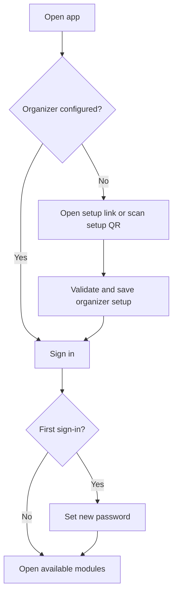

# App variants, distribution and organization setup

_Last updated: 2026-09-29_

The store offers two separately installed variants from the same codebase. Production uses bundle/package ID `com.tourmgmt.app` and scheme `tour-mgmt-app`; Test uses `com.tourmgmt.app.dev` and `tour-mgmt-app-dev`. EAS selects the variant at build time. Test builds use Dev credentials only; Production defaults to Prod and retains the configured store-reviewer routing. See [app variants and environments](app-variants-and-environments.md) and the [EAS build and release guide](../guides/eas-build-and-release.md).

The existing OrgConfig flow accepts organizer setup links or QR codes: `OrgSetupScreen.tsx` processes setup payloads and `AppConfigContext.tsx` stores the configuration used by authentication. This flow is dormant and out of scope for the app-variant change; its parsing, signing and runtime behavior are unchanged. Only its custom URL scheme is renamed.

`tools/setup-link-generator.html` is a publisher-side setup tool; `tools/push-eas-env.sh` helps configure EAS build environments. Keep signing material and organizer-specific settings out of public documentation. Consult [configuration](../guides/configuration.md), [release](../guides/release.md) and the detailed [EAS build guide](../guides/eas-build-and-release.md). The backend [deployment guide](https://github.com/kvijay77-in/tour-data-api/blob/main/docs/guides/deployment.md) owns infrastructure instructions.
