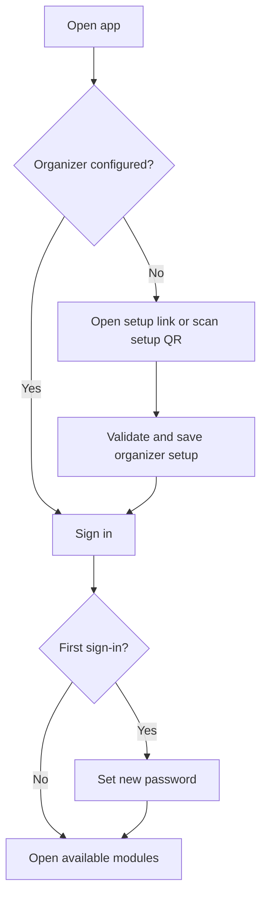

# App distribution and organization setup

_Last updated: 2026-09-29_

The app can be distributed as a single build to invited users of different organizers. On first launch `OrgSetupScreen.tsx` accepts an organizer setup link or QR code; `AppConfigContext.tsx` stores the validated configuration and `src/config/amplify.ts` configures authentication. When setup is already stored, the app proceeds to sign-in. A new device or reinstall needs the organizer's setup link or QR again. Runtime setup and any build-time fallback must not be confused with deploying backend resources.

`tools/setup-link-generator.html` is a publisher-side setup tool; `tools/push-eas-env.sh` helps configure EAS build environments. Keep signing material and organizer-specific settings out of public documentation. Consult [configuration](../guides/configuration.md) and [release](../guides/release.md). The backend [deployment guide](https://github.com/kvijay77-in/tour-data-api/blob/main/docs/guides/deployment.md) owns infrastructure instructions.
