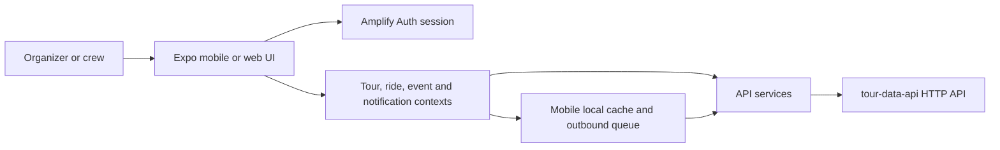

# Application architecture

_Last updated: 2026-09-29_

This repository is the Expo/React Native management client for mobile and web. `App.tsx` and the navigators assemble authentication, the home hub, Ride Day, Events, Hotels & Baggage and Administration screens. The app has **no infrastructure of its own**. [tour-data-api](https://github.com/kvijay77-in/tour-data-api) owns authentication, API, data and storage resources; the client obtains a session through Amplify Auth and makes HTTP requests through `src/services/api/apiClient.ts`. It never directly manages the backend data stores.

`src/navigation/RootNavigator.tsx` handles setup and auth transitions. `AppNavigator.tsx` registers permission-gated screens, while `modules.ts` defines Home/sidebar visibility and targets. `MainTabNavigator.tsx` handles Ride Day tabs. State providers live in `src/context/`; screens in `src/screens/`, reusable UI in `src/components/`, API adapters in `src/services/api/` and sync/storage in `src/services/sync/` and `src/services/database/`. `src/utils/logger.ts` centralizes logs.

The app supports iOS and Android through Expo and a narrower web experience. Mobile caches supported tour data and queues eligible operations while disconnected; web has no local database. Styling uses React Native StyleSheet and platform-specific adaptations. See [data integration](data-integration-and-offline.md), [app distribution](app-distribution.md) and [development guide](../guides/development.md).
