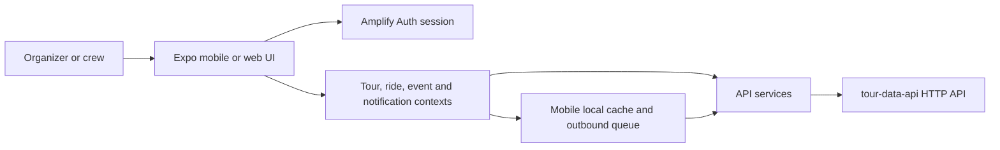

# Application architecture

_Last updated: 2026-09-29_

This repository is the Expo/React Native management client for mobile and web. `App.tsx` and the navigators assemble authentication, the home hub, Ride Day, Events, Hotels & Baggage and Administration screens. EAS builds the same code as two store variants: Test (`com.tourmgmt.app.dev`, `tour-mgmt-app-dev`) and Production (`com.tourmgmt.app`, `tour-mgmt-app`). The Test variant is built from EAS `preview` values and connects to Dev; Production uses EAS `production` values, with the existing app-reviewer route to Dev. Web hosting and publication are separate from mobile delivery; see [web build and deployment](web-deployment.md) and [app variants and environments](app-variants-and-environments.md).

This repository owns the static web hosting and publication infrastructure, but not the application's backend infrastructure. [tour-data-api](https://github.com/kvijay77-in/tour-data-api) owns authentication, API, data and storage resources; the client obtains a session through Amplify Auth and makes HTTP requests through `src/services/api/apiClient.ts`. It never directly manages the backend data stores.

Web resources are reconciled independently through SAM: the app-owned bootstrap stack creates scoped infrastructure/execution identities and a publisher permissions boundary; the existing hosting and publisher stacks retain their CloudFormation identities. Trusted `main` workflows build an environment-specific, checksummed static artifact without deployment credentials, reconcile hosting with a scoped infrastructure role, then publish only the validated artifact with the publisher role. A shared conditional S3 lease serializes local Dev and Actions mutations. Backend public values and the hosting `SiteUrl` are read through stack outputs, not cross-stack exports or app-triggered backend deployment; browser CORS preflight gates full publication. See the [web deployment design](web-deployment.md) and [operator guide](../guides/web-deployment.md).

## Authentication and backend profile

EAS selects the app identity and primary backend at build time: the `test` profile uses the Dev values in EAS `preview`, and `production` uses Prod values in EAS `production`. The Production-only reviewer username route reconfigures Amplify and the API client for the Dev reviewer profile before `signIn()`. A successful reviewer session is recorded in SecureStore; `App.tsx` restores that profile before mounting `AuthProvider`, whose first `getCurrentUser()` / `fetchAuthSession()` calls then use the matching Cognito pool. Sign-out clears the persisted marker. See [app variants and environments](app-variants-and-environments.md) for the EAS matrix and store process.

`src/navigation/RootNavigator.tsx` handles setup and auth transitions. `AppNavigator.tsx` registers permission-gated screens, while `modules.ts` defines Home/sidebar visibility and targets. `MainTabNavigator.tsx` handles Ride Day tabs. State providers live in `src/context/`; screens in `src/screens/`, reusable UI in `src/components/`, API adapters in `src/services/api/` and sync/storage in `src/services/sync/` and `src/services/database/`. `src/utils/logger.ts` centralizes logs.

The app supports iOS and Android through Expo and a narrower web experience. Mobile caches supported tour data and queues eligible operations while disconnected; web has no local database. Styling uses React Native StyleSheet and platform-specific adaptations. See [data integration](data-integration-and-offline.md), [app distribution](app-distribution.md) and [development guide](../guides/development.md).

Ride and event self-service policy resolution is centralized in `src/utils/rideSelfService.ts` and `src/utils/eventActivity.ts`; screens should use these helpers rather than duplicating inheritance rules.
