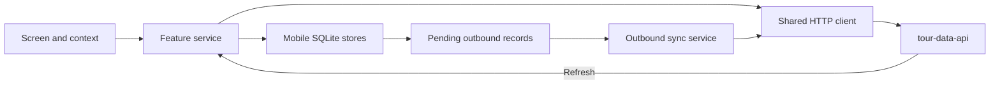

# Data integration and offline design

_Last updated: 2026-10-01_

`src/services/api/apiClient.ts` sends authenticated JSON/HTTP requests to the backend. Specialized adapters include `tourApi.ts`, `tourUserApi.ts`, `rideApi.ts`, `riderApi.ts`, `checkInApi.ts`, `dashboardApi.ts`, `eventsApi.ts`, `hotelsApi.ts`, `artifactApi.ts` and the notification services. The authoritative contract is the backend [API reference](https://github.com/kvijay77-in/tour-data-api/blob/main/docs/design/api-reference.md); this document describes only client behavior.

The mobile app caches tour, ride, rider, check-in, event and related lookup records using stores in `src/services/database/`; `database.web.ts` supplies the web-specific implementation. `offlineDataService.ts` serves cached reads when needed. `migrations.ts` maintains schema changes, while retention and sync metadata limit stale data. A signed-in user must load data before it can be used offline; the web client does not offer the same offline store.

`outboundSyncService.ts` coordinates eligible check-in and event-record submissions; `checkInSync.ts` and `eventSyncService.ts` handle their respective records, with retry/backoff and verification in `src/services/sync/`. An online check-in consults current server status; offline checks use local information provisionally and the server resolves conflicts during delivery. A Start-stage override, hotel allocation or other operation requiring an immediate live decision is not queued as an offline action. Sync Status and Advanced Settings surface readiness, failures and controls.

SQLite schema v5 migrates cached event definitions and occurrences to registration and self-service policy fields. It drops the obsolete informational columns without changing the shipped v1 migration; cached event/activity JSON and occurrence records remain available after upgrade. Event policy administration remains online-only, while cached reads continue to work offline.

The dashboard fetches ride/roster data separately from lightweight progress via `dashboardApi.ts`; rider popup details are loaded on demand. `dashboardEvents.ts` coordinates refresh triggers to avoid duplicate requests. The mobile cache is not a second authority: backend responses and authorization determine confirmed state.
