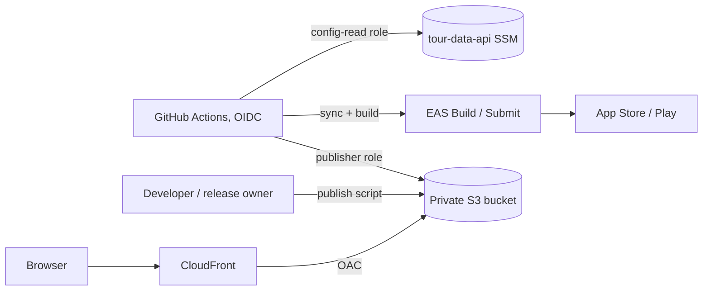

# Deployment design

_Last updated: 2026-11-19_

One manually started GitHub Actions workflow, [`.github/workflows/deploy.yml`](../../.github/workflows/deploy.yml), deploys both clients. The mobile apps are built and submitted to the stores by EAS. The web app is a static `expo export` served from a private S3 bucket through CloudFront. Backend resources (Cognito, API, data, file storage) belong to [tour-data-api](https://github.com/kvijay77-in/tour-data-api/blob/main/docs/guides/deployment.md), not this repository. Setup and operating steps are in the [deployment guide](../guides/deployment.md).

## Branches and identities

- **The branch decides the environment.** `develop` deploys dev and `main` deploys prod; any other ref fails before AWS or EAS is called.
- **Branch OIDC subjects, no GitHub Environments.** The tour-data-api config-read roles and the web publisher roles trust the exact subject `repo:kvijay77-in/tour-mgmt-app:ref:refs/heads/<branch>`. A job with `environment:` gets a different subject, and AWS rejects the role. Settings are therefore repository-level secrets and variables.
- **One AWS account per job.** Dev and prod are separate AWS accounts in `ap-south-1`. A production run reads the prod and dev backend values in separate jobs, so the two accounts' credentials never share a job.
- **EAS environment names.** The EAS free plan offers only the fixed `development`, `preview` and `production` environments, so the Test app uses `preview`.
- **Expo token scope.** The `EXPO_TOKEN` can write every EAS environment. The sync script enforces the branch mapping itself (`preview` only from `develop`, `production` only from `main`).

## Backend config handover

The backend publishes its public client values under `/tour-data-api/<env>/mgmt/*` in SSM. Every run reads them, so nothing is copied by hand:

- **Mobile.** [`tools/backend-config.mjs`](../../tools/backend-config.mjs) syncs the values into the EAS environment before each build and writes only what changed. Values are plaintext, because they ship inside the app. Each managed variable belongs to one EAS environment; a variable linked to several would change all of them when written, so the script splits it.
- **Store reviewer routing.** The Production app routes the configured reviewer username to Dev, so a production mobile run also reads the dev values for the `EXPO_PUBLIC_REVIEW_*` variables. The Test app has no reviewer routing.
- **Web.** The same values are passed to the web export through an allow-list. A local publish reads them from SSM too, so no copy of the backend values is kept in a local file.

## Web hosting ownership

- **Hosting stack** `tour-mgmt-web-<env>` (`infra/web.yaml`): deployed by a human account admin with `sam deploy --config-env <env>`. Rare; changes are reviewed in the change set. The bucket is retained on deletion and versioned; noncurrent versions expire after 30 days.
- **Publisher role** (optional, in the same template): created only when an existing GitHub OIDC provider ARN and an exact subject are supplied. Data-plane only: list/put/get on the bucket, `cloudfront:CreateInvalidation` on the distribution, `cloudformation:DescribeStacks` on its own stack. Trust is limited to audience `sts.amazonaws.com` and the exact subject.
- **Developers** publish with their own SSO profile holding the same five actions, plus `ssm:GetParametersByPath` on the backend handover path.
- Until branch protection exists, anyone who can push to `main` can deploy prod.

## Caching

Content-hashed assets are uploaded first with `public, max-age=31536000, immutable`. Other files use `no-cache`. `index.html` is uploaded last with `no-cache` so a release is never half-visible. A `/*` invalidation follows each publish.

## Content Security Policy

The response headers policy sends `Content-Security-Policy-Report-Only` by default (`CspMode=REPORT_ONLY`). Switch to `ENFORCE` through an infra update after QA confirms compatibility.

## Backend CORS contract

`SiteUrl` is handed to `tour-data-api` manually, once per environment; the backend does not read this stack. The backend allowlists it in its SAM parameter `ManagementWebAllowedOrigins`:

- Dev allows `SiteUrl` and `http://localhost:8081`; Prod allows the Prod `SiteUrl` only (https, no localhost). Any other origin must be requested from the backend team.
- The backend redeploys only when the origin changes (hosting stack recreated, custom domain added). Normal publishes need no backend change.
- Management API: allowed headers `Authorization`, `Content-Type`, `If-None-Match`; methods `GET`, `POST`, `PUT`, `DELETE`, `OPTIONS`; `ETag` exposed (conditional event reads return `304`).
- Artifacts bucket: browser `PUT` to presigned URLs (artifact and hotel CSV uploads) allowed from listed origins with the `Content-Type` header only.
- Prod order: deploy hosting stack, hand over `SiteUrl`, wait for the backend Prod deploy, then publish.

## Current state

Dev deploys through the workflow. Prod is blocked until the prod backend, hosting stack and store records exist ([production readiness](../guides/deployment.md#production-readiness)). Branch protection and optional push or pull-request triggers come later ([branch protection](../guides/deployment.md#later-branch-protection)).

## Out of scope

Custom domains, WAF, multi-region hosting and backend deployment.
