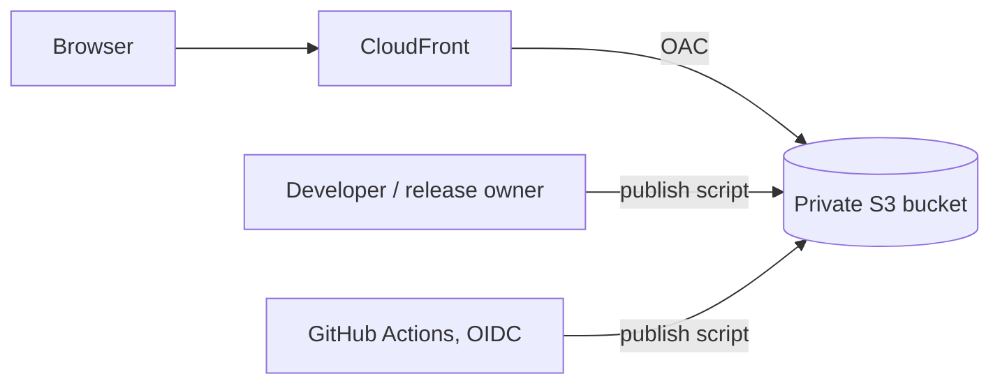

# Web build and deployment design

_Last updated: 2026-11-18_

The web app is a static `expo export` served from a private S3 bucket through CloudFront. Backend resources (Cognito, API, data, file storage) belong to [tour-data-api](https://github.com/kvijay77-in/tour-data-api/blob/main/docs/guides/deployment.md), not this repository.

## Ownership and identities

- **Hosting stack** `tour-mgmt-web-<env>` (`infra/web.yaml`): deployed by a human account admin with `sam deploy --config-env <env>`. Rare; changes are reviewed in the change set. The bucket is retained on deletion and versioned; noncurrent versions expire after 30 days.
- **Publisher role** (optional, in the same template): created only when a GitHub OIDC provider ARN and an exact subject are supplied. Data-plane only: list/put/get on the bucket, `cloudfront:CreateInvalidation` on the distribution, `cloudformation:DescribeStacks` on its own stack. Trust is limited to audience `sts.amazonaws.com` and the exact subject.
- **Developers** publish with their own SSO profile holding the same five actions.
- Dev and Prod use separate AWS accounts in `ap-south-1`. Prod CI publishing uses a GitHub-trusted Prod publisher role limited to `main`; until branch protection exists, anyone who can push to `main` can publish Prod.

## Stages

1. Private repo: admin deploys Dev hosting; a developer publishes Dev with the script.
2. Private repo, manual CI (implemented in `.github/workflows/deploy.yml`, see the [deployment workflow guide](../guides/deployment-workflow.md)):
   - The workflow publishes Dev from `develop` and Prod from `main` when started manually.
   - The publisher role trusts only the branch subject `repo:kvijay77-in/tour-mgmt-app:ref:refs/heads/<branch>`.
   - Build values come from the tour-data-api SSM handover.
   - Prod stays blocked until the Prod hosting stack and its publisher role exist.
3. Later: branch protection on `develop` and `main`, and optional push or pull-request triggers. Deployment jobs keep branch subjects (no GitHub Environments), because the backend config-read roles trust branches only.

## Caching

Content-hashed assets are uploaded first with `public, max-age=31536000, immutable`. Other files use `no-cache`. `index.html` is uploaded last with `no-cache` so a release is never half-visible. A `/*` invalidation follows each publish.

## Content Security Policy

The response headers policy sends `Content-Security-Policy-Report-Only` by default (`CspMode=REPORT_ONLY`). Switch to `ENFORCE` through an infra update after QA confirms compatibility.

## Backend CORS contract

`SiteUrl` is handed to `tour-data-api` manually, once per environment; the backend does not read this stack. The backend allowlists it in its SAM parameter `ManagementWebAllowedOrigins`:

- Dev allows `SiteUrl` and `http://localhost:8081`; Prod allows the Prod `SiteUrl` only (https, no localhost). Any other origin must be requested from the backend team.
- The backend redeploys only when the origin changes (hosting stack recreated, custom domain added). Normal publishes need no backend change.
- Management API: allowed headers `Authorization`, `Content-Type`, `If-None-Match`; methods `GET`, `POST`, `PUT`, `DELETE`, `OPTIONS`; `ETag` exposed (conditional event reads return `304`).
- Artifacts bucket: browser `PUT` to presigned URLs (artifact and hotel CSV uploads) allowed from listed origins with the `Content-Type` header only.
- Prod order: deploy hosting stack, hand over `SiteUrl`, wait for the backend Prod deploy, then publish.

## Rollback

Republish an older commit or tag.

## Out of scope

Custom domains, WAF, multi-region hosting and backend deployment.
