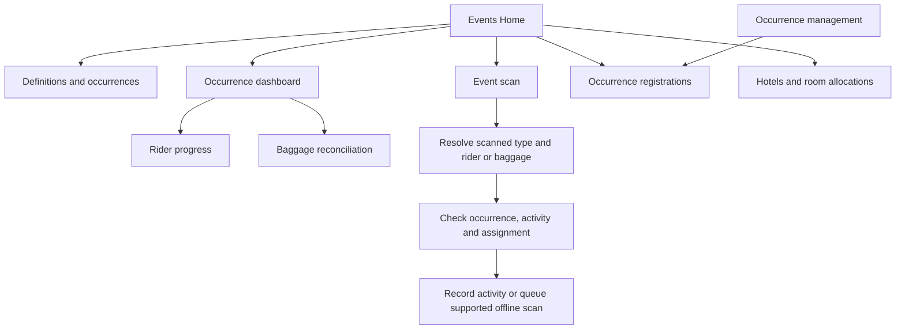

# Events and hotels design

_Last updated: 2026-10-01_

`AppNavigator.tsx` registers `EventsHome`, `EventDefinitionList`, `EventDefinitionEditor`, `OccurrenceManagement`, `OccurrenceRegistrations`, `EventOccurrence` (tabbed dashboard: Event progress | Scan | Activity Log), `BaggageReconciliation`, `RiderProgress`, `HotelManagement`, `HotelAllocationUpload`, `HotelAllocationAdjust` and `RiderExit` behind permission gates. The Events and Hotels & Baggage Home tiles use the same gates through `src/navigation/modules.ts`.

**Events screen (`EventsHome`)**: lists today's occurrences grouped by event (name, location; row = `#seq`, status badge, chevron). ACTIVE/COMPLETED rows open `EventOccurrence` when the user has at least one permitted tab; PLANNED/CANCELLED rows are disabled. PS_x/Hotel Staff see an occurrence only if an activity is available to them or they have VIEW_DASHBOARD. A compact "Manage" section (online only) links to definitions, per-event occurrences and per-occurrence registrations, by permission.

`EventSessionContext.tsx` carries the selected event/occurrence session across screens and queue counters. `eventsApi.ts` and `hotelsApi.ts` send requests through the shared HTTP client; `eventBootstrapService.ts` loads local event data and `eventDashboardService.ts` prepares dashboard views. `eventStore.ts`, `eventRecordStore.ts` and `hotelStayStore.ts` hold mobile cached data; `eventSyncService.ts` handles supported pending event records. Hotel management and allocation changes require a live connection.

Scanning resolves the code type before presenting an activity confirmation; a rider QR code cannot silently be used as a baggage code. Occurrence status and activity assignment limit choices. Administrators can edit definitions and occurrences; Super Users can manage occurrences; assigned crew can scan eligible activities. The UI has its own `Permission.MANAGE_EVENT_OCCURRENCES` identifier in `src/types/models.ts`; **backend permission names and semantics must be checked against [backend RBAC](https://github.com/kvijay77-in/tour-data-api/blob/main/docs/design/rbac.md)** rather than treating the client identifier as a backend contract.

Event registration defaults off. When enabled, rider registration is required for event records and can be changed only while an occurrence is `PLANNED`; when disabled, every rider on the tour counts as registered. Event definition, activity, occurrence and activity-override self-service settings are independent nullable/optional policy levels, not informational badges. The resolution order is:

`OccurrenceRegistrationsScreen.tsx` reads the registrations endpoint through `eventsApi.ts`, uses `NameDirectoryContext` for staff rider selection, and permits changes only online while the occurrence is `PLANNED`. Its route and entry actions are gated by `MANAGE_EVENT_REGISTRATIONS`. Expected registration failures use `getEventErrorMessage`; `EventScanTab` formats `RIDER_NOT_REGISTERED_FOR_EVENT` with the scanned rider ID. Per S-6, the scan rejection has no registration shortcut because the occurrence must be active to scan but planned to change registrations.

| Level (first set wins) | Meaning |
| --- | --- |
| Occurrence activity override | Per-activity choice for one occurrence; `null` clears it |
| Occurrence | Setting for all activities on one occurrence; `null` returns to inheritance |
| Activity definition | Default for one activity across occurrences |
| Event definition | Default for activities without a more specific value |
| Default | Not allowed |

For example, with event self-service disabled, an activity set to allowed is allowed on ordinary occurrences. An occurrence-level not-allowed value overrides it for every activity on that date, while a single activity override can explicitly allow one activity again. `getEffectiveSelfServiceAllowed` in `src/utils/eventActivity.ts` is the shared client resolver. The former informational event self-service setting was removed; SQLite schema v5 replaces its cached columns with registration and policy fields while retaining cached event and occurrence records. Event dashboard activity cells and rider-detail timelines do not include a check-in method, so they cannot show the `Self` label there (BC-3).

See [requirements](../requirements/events-hotels-baggage.md) and the [backend API reference](https://github.com/kvijay77-in/tour-data-api/blob/main/docs/design/api-reference.md).

## Event dashboard data (foundation)

`GET .../dashboard` returns `{ event, occurrence, riders, records, cancelled, summary }` (ETag/304 reused); `.../dashboard/progress` returns `{ eventId, occurrenceId, records, cancelled, summary, dataVersion }` without the roster. `OccurrenceDashboardContext.tsx` holds the state for one occurrence: it loads the dashboard, polls progress every 15 s while the screen is focused, the occurrence is ACTIVE, the device is online and the data is not stale, and refetches the full dashboard when `summary.totalRiders` or the activity list differs from the roster held. Without `VIEW_DASHBOARD` no dashboard or progress call is made; only the event and occurrence are loaded.

- **Done** means COMPLETED, OPTED_OUT or FLAGGED; PENDING and QUEUED are not done. FLAGGED applies to a record with `isFlagged` (baggage scans whose timestamp precedes the rider's baggage release, from late offline sync), otherwise the record outcome is used.
- **QUEUED** is a client-only status: this device's unsynced local scans override a PENDING server status and do not change server totals.
- Activities for the stepper, filter and totals follow `summary.activities`, mapped to the event's activities and ordered by `sequenceNo`; without a summary the effective-enabled activities are used.
- Pure helpers (statuses, sorting, totals, log merging) are in `src/utils/eventProgress.ts`. Filter and sort state is shared across dashboard tabs and resets when another occurrence is opened.
- The snapshot in `event_dashboard_snapshots` is `{ tourId, dashboard, reconciliation }`, where `dashboard` is the full payload with progress merged in. A stored snapshot without `dashboard.summary` (older format) is treated as not saved.

## Tabbed occurrence dashboard

`EventOccurrence` (`navigation/EventOccurrenceTabNavigator.tsx`) wraps `OccurrenceDashboardProvider` and a bottom-tab navigator. **Event progress** (`EventProgressTab`) needs `VIEW_DASHBOARD`; **Scan** (`EventScanTab`) needs `EVENT_SCAN` and an `ACTIVE` occurrence; **Activity Log** (`EventActivityLogTab`) is shown when the user has `VIEW_DASHBOARD` or `EVENT_SCAN`. `initialTab` is honoured only for a permitted tab; otherwise Event progress, then Scan, then Log.

Event progress shows a rider-ID row with a label-free stepper per activity; the activity dropdown zooms in on one activity (zoom-out button clears it), the sort toggle orders fewest-done first (zoomed: not done first), and tapping a row opens `EventRiderCardModal`. Totals come from `summary`; the reconciliation tile is on this tab.

Activity Log merges server `records[]` and `cancelled[]` with this device's local event records. It shares the same activity filter as Event progress, shows local-time rows with outcome badges (`Opted out`, `Flagged`, `Self`) and sync badges for device records (`Queued`, `Failed`), and includes cancellation details (time, user, reason). Failed local records can be retried from the log; cancel/remove actions are available for scan-permitted users while the occurrence is active. Users without `VIEW_DASHBOARD` see device-only records for the occurrence plus an informational note.

Scan tab keeps scanning, manual entry, confirmation and last-result feedback; recent scans and sync-issue management live in Activity Log.
