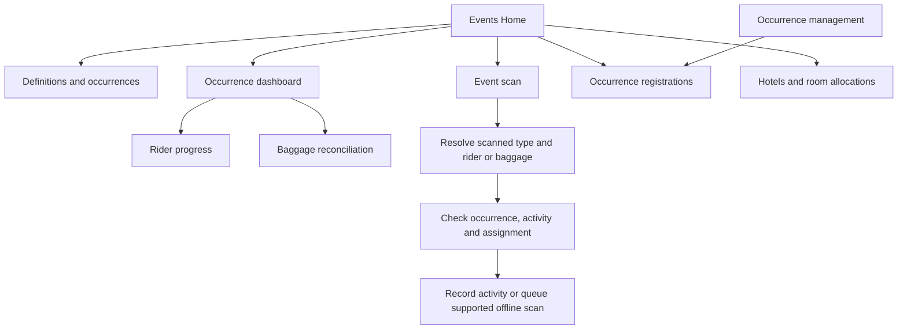

# Events and hotels design

_Last updated: 2026-10-01_

`AppNavigator.tsx` registers `EventsHome`, `EventDefinitionList`, `EventDefinitionEditor`, `OccurrenceManagement`, `OccurrenceRegistrations`, `EventScan`, `OccurrenceDashboard`, `BaggageReconciliation`, `RiderProgress`, `HotelManagement`, `HotelAllocationUpload`, `HotelAllocationAdjust` and `RiderExit` behind permission gates. The Events and Hotels & Baggage Home tiles use the same gates through `src/navigation/modules.ts`.

`EventSessionContext.tsx` carries the selected event/occurrence session across screens. `eventsApi.ts` and `hotelsApi.ts` send requests through the shared HTTP client; `eventBootstrapService.ts` loads local event data and `eventDashboardService.ts` prepares dashboard views. `eventStore.ts`, `eventRecordStore.ts` and `hotelStayStore.ts` hold mobile cached data; `eventSyncService.ts` handles supported pending event records. Hotel management and allocation changes require a live connection.

Scanning resolves the code type before presenting an activity confirmation; a rider QR code cannot silently be used as a baggage code. Occurrence status and activity assignment limit choices. Administrators can edit definitions and occurrences; Super Users can manage occurrences; assigned crew can scan eligible activities. The UI has its own `Permission.MANAGE_EVENT_OCCURRENCES` identifier in `src/types/models.ts`; **backend permission names and semantics must be checked against [backend RBAC](https://github.com/kvijay77-in/tour-data-api/blob/main/docs/design/rbac.md)** rather than treating the client identifier as a backend contract.

Event registration defaults off. When enabled, rider registration is required for event records and can be changed only while an occurrence is `PLANNED`; when disabled, every rider on the tour counts as registered. Event definition, activity, occurrence and activity-override self-service settings are independent nullable/optional policy levels, not informational badges. The resolution order is:

`OccurrenceRegistrationsScreen.tsx` reads the registrations endpoint through `eventsApi.ts`, uses `NameDirectoryContext` for staff rider selection, and permits changes only online while the occurrence is `PLANNED`. Its route and entry actions are gated by `MANAGE_EVENT_REGISTRATIONS`. Expected registration failures use `getEventErrorMessage`; `EventScanScreen` formats `RIDER_NOT_REGISTERED_FOR_EVENT` with the scanned rider ID. Per S-6, the scan rejection has no registration shortcut because the occurrence must be active to scan but planned to change registrations.

| Level (first set wins) | Meaning |
| --- | --- |
| Occurrence activity override | Per-activity choice for one occurrence; `null` clears it |
| Occurrence | Setting for all activities on one occurrence; `null` returns to inheritance |
| Activity definition | Default for one activity across occurrences |
| Event definition | Default for activities without a more specific value |
| Default | Not allowed |

For example, with event self-service disabled, an activity set to allowed is allowed on ordinary occurrences. An occurrence-level not-allowed value overrides it for every activity on that date, while a single activity override can explicitly allow one activity again. `getEffectiveSelfServiceAllowed` in `src/utils/eventActivity.ts` is the shared client resolver. The former informational event self-service setting was removed; SQLite schema v5 replaces its cached columns with registration and policy fields while retaining cached event and occurrence records. Event dashboard activity cells and rider-detail timelines do not include a check-in method, so they cannot show the `Self` label there (BC-3).

See [requirements](../requirements/events-hotels-baggage.md) and the [backend API reference](https://github.com/kvijay77-in/tour-data-api/blob/main/docs/design/api-reference.md).
