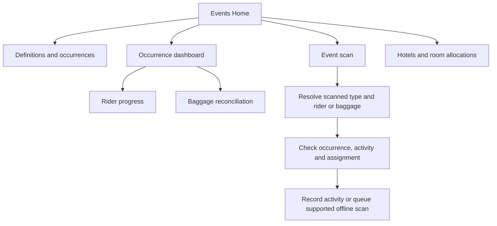

# Events and hotels design

_Last updated: 2026-09-29_

`AppNavigator.tsx` registers `EventsHome`, `EventDefinitionList`, `EventDefinitionEditor`, `OccurrenceManagement`, `EventScan`, `OccurrenceDashboard`, `BaggageReconciliation`, `RiderProgress`, `HotelManagement`, `HotelAllocationUpload`, `HotelAllocationAdjust` and `RiderExit` behind permission gates. The Events and Hotels & Baggage Home tiles use the same gates through `src/navigation/modules.ts`.

`EventSessionContext.tsx` carries the selected event/occurrence session across screens. `eventsApi.ts` and `hotelsApi.ts` send requests through the shared HTTP client; `eventBootstrapService.ts` loads local event data and `eventDashboardService.ts` prepares dashboard views. `eventStore.ts`, `eventRecordStore.ts` and `hotelStayStore.ts` hold mobile cached data; `eventSyncService.ts` handles supported pending event records. Hotel management and allocation changes require a live connection.

Scanning resolves the code type before presenting an activity confirmation; a rider QR code cannot silently be used as a baggage code. Occurrence status and activity assignment limit choices. Administrators can edit definitions and occurrences; Super Users can manage occurrences; assigned crew can scan eligible activities. The UI has its own `Permission.MANAGE_EVENT_OCCURRENCES` identifier in `src/types/models.ts`; **backend permission names and semantics must be checked against [backend RBAC](https://github.com/kvijay77-in/tour-data-api/blob/main/docs/design/rbac.md)** rather than treating the client identifier as a backend contract. See [requirements](../requirements/events-hotels-baggage.md) and the [backend API reference](https://github.com/kvijay77-in/tour-data-api/blob/main/docs/design/api-reference.md).
