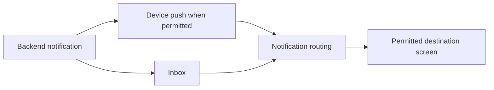

# Notifications design

_Last updated: 2026-09-29_

The notification bell and `NotificationsScreen.tsx` provide inbox access. `NotificationContext.tsx` maintains client state; `notificationApi.ts`, `notificationRuleApi.ts`, `pushService.ts` and notification routing helpers handle retrieval, push registration and navigation. `NotificationAnnounceScreen.tsx`, `NotificationRemindersScreen.tsx` and `NotificationRulesScreen.tsx` are permission-gated management surfaces; server authorization remains authoritative.

Notification limits are loaded via `notificationLimitsService.ts`; form validation and routing live in `src/utils/notificationRules.ts`, `notificationRuleForm.ts` and `notificationRouting.ts`. If a destination is unavailable to the signed-in user, do not bypass navigation permissions. See [notification requirements](../requirements/notifications.md) and backend [API reference](https://github.com/kvijay77-in/tour-data-api/blob/main/docs/design/api-reference.md).
