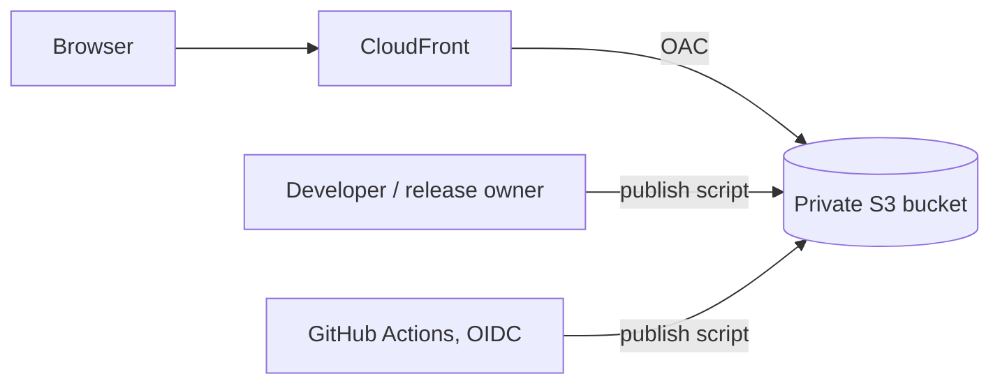

# Web build and deployment design

_Last updated: 2026-10-05_

The web app is a static `expo export` served from a private S3 bucket through CloudFront. Backend resources (Cognito, API, data, file storage) belong to [tour-data-api](https://github.com/kvijay77-in/tour-data-api/blob/main/docs/guides/deployment.md), not this repository.

## Ownership and identities

- **Hosting stack** `tour-mgmt-web-<env>` (`infra/web.yaml`): deployed by a human account admin with `sam deploy --config-env <env>`. Rare; changes are reviewed in the change set. The bucket is retained on deletion and versioned; noncurrent versions expire after 30 days.
- **Publisher role** (optional, in the same template): created only when a GitHub OIDC provider ARN and an exact subject are supplied. Data-plane only: list/put/get on the bucket, `cloudfront:CreateInvalidation` on the distribution, `cloudformation:DescribeStacks` on its own stack. Trust is limited to audience `sts.amazonaws.com` and the exact subject.
- **Developers** publish with their own SSO profile holding the same five actions.
- Dev and Prod use separate AWS accounts in `ap-south-1`. Until the repository is public, Prod is gated by AWS account access (only the release owner has it); no GitHub-trusted Prod role exists.

## Stages

1. Private repo: admin deploys Dev hosting; a developer publishes Dev with the script.
2. Private repo: Dev publishes from CI on push to `develop` (subject `repo:<owner>/<repo>:ref:refs/heads/develop`); Prod is published manually from a clean checkout whose HEAD is an ancestor of `origin/main`.
3. Public repo: GitHub Environments `web-dev`/`web-prod` with required reviewers and branch protection; Prod through CI with an environment-based subject.

## Caching

Content-hashed assets are uploaded first with `public, max-age=31536000, immutable`. Other files use `no-cache`. `index.html` is uploaded last with `no-cache` so a release is never half-visible. A `/*` invalidation follows each publish.

## Content Security Policy

The response headers policy sends `Content-Security-Policy-Report-Only` by default (`CspMode=REPORT_ONLY`). Switch to `ENFORCE` through an infra update after QA confirms compatibility.

## Backend CORS contract

`tour-data-api` reads `SiteUrl` from stack `tour-mgmt-web-<env>` (tags `Project=tour-mgmt-app`, `Environment=<env>`, region `ap-south-1`) at backend deploy time. Stack names, region, tags and the https `SiteUrl` output must not change. Rerun the backend deploy only when the origin changes.

## Rollback

Republish an older commit or tag.

## Out of scope

Custom domains, WAF, multi-region hosting and backend deployment.
