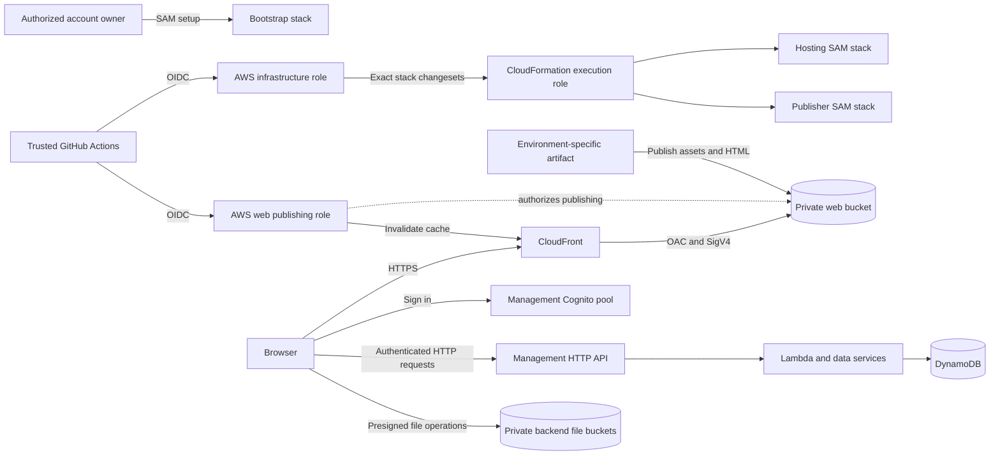

# Web build and deployment

_Last updated: 2026-10-03_

This design defines static hosting and automated deployment for the management app's web build. The existing Expo/React Native codebase is exported as a client-rendered application and served over HTTPS through Amazon CloudFront from a private Amazon S3 bucket. Authentication and business operations continue to use the matching backend owned by [tour-data-api](https://github.com/kvijay77-in/tour-data-api).

Web hosting is independent of mobile delivery. EAS continues to build and distribute the Test and Production mobile variants; web releases do not invoke EAS Build or EAS Update. See [application architecture](architecture.md) and [app variants and environments](app-variants-and-environments.md).

## Architecture and ownership

| Responsibility | Owner |
| --- | --- |
| Web export, hosting templates, publication and rollback | `tour-mgmt-app` |
| Cognito, API Gateway, Lambda, DynamoDB and private file storage | `tour-data-api` |
| Public platform overview and functional documentation | `cycling-tour-platform` |
| Mobile builds and store distribution | Existing EAS release process |

The hosting bucket contains application files only. Tour data, rider information and private artifacts remain in backend-managed resources. Hosting and backend stacks have separate lifecycles and do not depend on cross-stack exports. Bootstrap is administered with the account owner's approved AWS identity; routine infrastructure reconciliation uses a separate short-lived role and execution role. Publishing uses a third role and cannot modify hosting infrastructure or backend resources.

## Application model

The application uses Expo 57, React Native Web and React Navigation. Its entry point is [App.tsx](../../App.tsx), and the web build is a single-page, client-rendered application rather than an Expo Router server or per-route static site. `npx expo export --platform web` produces HTML, JavaScript and static assets without a Node server runtime.

The root document is `index.html`. React Navigation manages screen state inside the application; the current `NavigationContainer` has no URL-linking configuration. A page refresh follows normal application startup and authentication rather than restoring a screen from its URL. The hosting layer does not add screen-specific routing or convert all 403/404 responses into successful HTML responses. Missing assets and permission failures remain errors.

The existing Expo configuration is retained. [app.config.ts](../../app.config.ts) merges [app.json](../../app.json) and selects the app variant. Web build settings and public backend values are supplied by the web build environment, independently of mobile EAS configuration.

## Environments

| Setting | Dev | Production |
| --- | --- | --- |
| AWS account | Development account | Separate Production account |
| Hosting region | `ap-south-1` | `ap-south-1` |
| GitHub Environment | `web-dev` | `web-prod` |
| App variant | `test` | `production` |
| Backend | Matching Dev Cognito and API | Matching Production Cognito and API |
| Publication trigger | Manual selection of a source branch | Relevant changes to `main`, with required approval |

Each environment has its own bucket, distribution, publishing role and build configuration. Dev uses one shared site: publishing another development branch replaces the previously published Dev release. There are no per-branch preview sites.

CloudFront uses its default HTTPS domain and certificate. `PriceClass_200` includes India, the primary user geography. CloudFront is global; API response latency still depends on the backend region. Hosting configuration does not migrate backend resources.

Production publication is controlled by `WEB_PRODUCTION_ENABLED`, disabled by default. This setting is independent of Dev publication. Production permissions remain restricted to the `main` workflow and its protected GitHub Environment.

## Hosting resources

The web stack is defined in [`infra/web.yaml`](../../infra/web.yaml) with environment, owner/project metadata and reviewed CSP parameters.

| Resource | Configuration |
| --- | --- |
| Web bucket | Private, SSE-S3 encrypted, versioned, all public-access blocks enabled |
| Bucket policy | Deny insecure transport; allow CloudFront reads only for the matching distribution |
| Origin Access Control | S3 origin with SigV4 signing |
| Distribution | S3 REST origin, HTTPS redirect, compression and `index.html` default root |
| Cache policy | Minimum TTL 0, default TTL 0, maximum TTL 31,536,000 seconds; no cookies, headers or query strings in the cache key |
| Response headers policy | HSTS, content-type protection, frame denial, referrer policy and explicitly selected CSP mode |

The S3 website endpoint is not used. CloudFront OAC provides origin access; the bucket is not publicly readable. The distribution accepts the read methods required for static content and does not forward application authentication to S3.

The bucket is retained on stack deletion or replacement, and stack termination protection protects infrastructure from accidental deletion. A lifecycle rule expires only noncurrent versions after 30 days; it does not delete current objects or old content-hashed keys. Resources carry project, environment, owner and management tags where tagging is supported. A conditional `.web-deploy-lock` object coordinates deployments and is explicitly denied to CloudFront viewers.

Stack outputs include `BucketName`, `DistributionId` and `SiteUrl`. Publisher permissions use the actual output identities rather than assuming that a generated bucket name matches a naming prefix.

## Infrastructure lifecycle and identities

SAM reconciles three independent stacks using the existing templates directly; the templates contain ordinary CloudFormation resources and do not require `sam build` or an artifact bucket:

| Stack | Responsibility | Identity contract |
| --- | --- | --- |
| Bootstrap (`tour-mgmt-web-deploy-{env}`) | Account OIDC provider ownership, infrastructure role, CloudFormation execution role and publisher boundary | Created/updated only by the approved account owner; termination-protected; routine infrastructure cannot update it |
| Hosting (`tour-mgmt-web-{env}`) | Existing S3/CloudFront resources in `infra/web.yaml` | Existing logical IDs and physical resources are retained; new buckets use a stable account-scoped name |
| Publisher (`tour-mgmt-web-publisher-{env}`) | Existing GitHub publisher role in `infra/github-oidc.yaml` | Exact bucket/distribution outputs and the bootstrap-owned boundary are applied without replacing the role |

The infrastructure role trusts only the matching `web-dev` or `web-prod` GitHub Environment subject and the explicitly configured local deployment principal. It can operate only on the exact hosting and publisher stack names, read the configured backend stack, inspect the account OIDC provider inventory, and pass only the dedicated execution role. Production full deployment is restricted to the approved main workflow; local Production operations are setup, status and explicitly infrastructure-only reconciliation.

The CloudFormation execution role provisions the hosting resource types and manages only the named publisher role with the required permissions boundary. The boundary is owned by bootstrap, permits access to the exact web bucket and only CloudFront distributions carrying the matching project/environment tags, and contains no IAM or backend permissions. CloudFront create/list operations and account OIDC provider listing are unavoidable resource-scope exceptions; resource tagging, exact account/resource namespaces and stack conditions constrain the remaining permissions. Origin Access Control updates use only this account's OAC ARN namespace because that resource type does not expose compatible tags. The routine role cannot update the boundary, provider or bootstrap roles.

OIDC ownership is stable across reruns. An existing provider with the expected URL and `sts.amazonaws.com` audience is reused without modification. If no provider exists, bootstrap creates and retains it. If an older publisher stack owns the provider, bootstrap references it while the publisher stack keeps ownership. Multiple providers, URL/audience mismatches, ownership changes and ambiguous condition transitions stop for review.

Each SAM deploy creates a change set with explicit stack, template, configuration environment and parameters. Empty change sets are successful. The command rejects resource deletion, replacement, conditional replacement and unknown change actions before execution; it enables termination protection and waits for stack and CloudFront readiness. Failed/in-progress stacks require operator review; the command does not delete, recreate or automatically roll back infrastructure.

## Caching and asset retention

| Content | Object `Cache-Control` |
| --- | --- |
| Verified content-hashed JavaScript, CSS and other assets | `public,max-age=31536000,immutable` |
| HTML, favicon, metadata and other nonhashed files | `no-cache` |

The cache policy honors origin cache-control directives with a zero minimum TTL. Cookies, authorization headers and unnecessary query strings are excluded from the static-content cache key. Compression is enabled.

Immutable caching applies to content-hashed files, not to every file under `assets/` or `_expo/`. Source maps are excluded from public publication by default.

Previously published hashed assets remain available so an open browser session or older HTML document can continue loading its dependencies. Expiring noncurrent S3 versions does not remove obsolete assets with unique object keys. Current release dependencies are not subject to blanket object expiry.

## Application configuration

[App.tsx](../../App.tsx) first loads stored organizer configuration through `loadOrgConfig()`. Without stored configuration, it uses the existing public environment fallback. `configureAmplify()` in [src/config/amplify.ts](../../src/config/amplify.ts) configures Cognito; [src/services/api/apiClient.ts](../../src/services/api/apiClient.ts) uses the configured API base URL.

| Variable | Web configuration |
| --- | --- |
| `APP_VARIANT` | `test` for Dev; `production` for Production |
| `EXPO_PUBLIC_AWS_REGION` | Matching backend region |
| `EXPO_PUBLIC_AWS_USER_POOL_ID` | Management Cognito pool |
| `EXPO_PUBLIC_AWS_USER_POOL_WEB_CLIENT_ID` | Existing public management app client |
| `EXPO_PUBLIC_AWS_IDENTITY_POOL_ID` | Optional, only where used |
| `EXPO_PUBLIC_TOUR_DATA_API_BASE_URL` | Matching HTTPS management API URL, including stage path |
| `EXPO_PUBLIC_USE_MOCK_DATA` | `false` |
| `EXPO_PUBLIC_QR_DEV_FORMAT` | `false` |
| `EXPO_PUBLIC_ENVIRONMENT` | Environment-specific application value |
| `EXPO_PUBLIC_LOG_LEVEL` | Environment-appropriate logging level |
| `EXPO_PUBLIC_API_DEBUG_GET` | Disabled |
| `EXPO_PUBLIC_REVIEW_*` | Unset |
| `EXPO_PUBLIC_SETUP_HMAC_KEY` | Unset |

Public variables are embedded in the web bundle. They contain identifiers and endpoints, never passwords, tokens, credentials or confidential signing material. The dormant setup-link feature is not used to configure these deployments. Reviewer routing is disabled for web builds by omitting its variables.

Stored organizer configuration has precedence over build-time defaults. On web, [src/services/config/orgConfigService.ts](../../src/services/config/orgConfigService.ts) stores non-secret organizer configuration in browser `localStorage`. Publication does not modify or clear browser storage.

AWS deployment settings, including expected account ID, publishing role ARN and hosting resource identities, are distinct from application public variables. Web builds do not require an EAS token, Firebase configuration or long-lived AWS keys.

The structured, ignored `tools/web-deployment.<env>.json` configuration names the expected account, regions, stable stacks, backend stack/output labels, owner metadata, CSP, owner-confirmed API/artifact preflight URLs and explicitly approved GitHub reviewers. The checked-in [`tools/web-deployment.example.json`](../../tools/web-deployment.example.json) contains placeholders only. The command reads output values directly from CloudFormation; a configured Cognito override is explicit, and absent required values fail closed. The API base URL is validated as HTTPS and used as returned, including its stage path. `tools/web-deployment-toolchain.json` pins the tested Node, SAM CLI and AWS CLI major versions.

Each environment receives a separate build because public values are embedded at export time. Dev artifacts are not promoted unchanged to Production, and there is no additional runtime-config fetch mechanism.

## Authentication and browser security

[AuthContext](../../src/context/AuthContext.tsx) uses Amplify's direct `USER_PASSWORD_AUTH` flow with the existing management Cognito public client. Session handling, token refresh and sign-out remain in the existing application. The backend validates tokens and enforces permissions for both mobile and web.

Hosted UI, OAuth callback/logout URLs, a new user pool and a new authentication flow are not part of this design. Browser token storage remains under the existing Amplify behavior; this design does not add a backend-for-frontend, cookie session or token-storage replacement. Browser-accessible tokens remain exposed to the consequences of successful XSS.

CloudFront supplies HTTPS, HSTS, content-type protection, frame denial and an appropriate referrer policy. A clean export inspected for the hosting policy had no inline scripts, external HTML resource origins or event-handler attributes, and had one inline style block. The hosting template requires a CSP value reviewed against the exported application and actual service origins. CSP is report-only by default and can be enforced only after compatibility review, including React Native Web's generated styles. The build-time API, Cognito and file origins are environment supplied and must be included only when approved. Report-only policy does not enforce restrictions and does not send reports without a configured reporting endpoint. No reporting service, blanket source allowlist or `unsafe-eval` is assumed.

## Build and publishing trust

Workflow definitions and publishing helpers are taken from trusted `main` code. Manual Dev publication supplies a `source_ref`, resolved once to a commit SHA. The selected application source is built without AWS permissions.

The build uses a pinned compatible Node runtime, `npm ci` with the existing lockfile, required lint and type checks, release tests and the Expo export. It consumes explicit environment configuration rather than local populated `.env` files. Invalid configuration or an invalid export prevents publication.

The build artifact includes a deployment manifest recording the source commit, trusted helper/workflow commits, app variant, environment, public-config fingerprint, toolchain/release identity, and per-file SHA-256 hashes, MIME types and cache classifications. Export validation requires one root `index.html`, resolved safe local HTML/CSS references, no source maps or likely embedded secrets, and verified content hashes before immutable classification. Public configuration and artifacts are environment-specific. GitHub Environment values are available only to correctly environment-scoped jobs; the Production approval gate precedes build and AWS jobs. The repository-scoped `WEB_PRODUCTION_ENABLED` switch is false until the authorized owner enables it.

A separate publishing job consumes the validated artifact and trusted publishing code. It does not install dependencies or execute scripts from the selected development branch while holding AWS credentials. The job graph separates build/validation, scoped infrastructure, lease acquisition and publisher-only upload; build has no AWS role or GitHub administration token. Only AWS jobs receive `id-token: write`; other jobs use read-only repository access. Production pushes to `main` run only for relevant app/export/template/config/helper/workflow changes; trusted-main Dev dispatch is optional and local Dev deployment remains primary.

GitHub OIDC is exchanged for short-lived AWS credentials. Trust is restricted to `sts.amazonaws.com` as audience and the exact repository/environment subject. Production also requires GitHub Environment approval and a `main` deployment restriction. These controls complement the IAM trust policy; environment-based OIDC subjects do not encode the branch.

[`infra/github-deploy.yaml`](../../infra/github-deploy.yaml) owns the infrastructure role, execution role and publisher boundary. [`infra/github-oidc.yaml`](../../infra/github-oidc.yaml) owns the separate publisher role, whose trust requires audience `sts.amazonaws.com` and the exact `repo:kvijay77-in/tour-mgmt-app:environment:web-dev` or `...:environment:web-prod` subject. The publisher uses the exact hosting outputs and can list the bucket, read/write site objects, invalidate/inspect only the matching project/environment distribution, and conditionally manage only `.web-deploy-lock` under its boundary. It cannot delete published site objects, manage IAM/CloudFormation or change backend resources. Dev alone permits the configured local principal to assume its publisher role; Production is OIDC-only. The provider ARN and original owner mode come from the bootstrap stack; a legacy publisher-owned provider stays with that stack.

Routine publishing permissions cover only required object/list operations and cache invalidation/status access. The infrastructure role ARN, execution role ARN, boundary ARN and OIDC provider ARN are bootstrap outputs; bucket, distribution and site origin are hosting outputs; publisher role ARN is a publisher output. Actual account IDs and backend values are supplied through ignored environment config during authorized setup. The backend API base URL and Cognito values are resolved by exact configured CloudFormation output labels, with explicit external Cognito overrides where approved. The API URL is consumed exactly as output, including its stage path; the app does not infer or append a stage.

Official GitHub Actions are pinned to reviewed immutable revisions. Local Dev and Actions hold the same S3 lease across the complete mutating operation. Lease creation requires `If-None-Match: *`; release and recovery require the same owner and observed ETag. Failure cleanup releases only its own lease; explicitly audited recovery accepts only an exact owner older than six hours, verifies Actions run/attempt completion, and checks same-workstation local process inactivity. Workflow concurrency also serializes deployment and rollback with `cancel-in-progress: false`.

## Publication and rollback

Publication uploads content-hashed dependencies first, other non-entry files next, and `index.html` last. This order prevents the new entry document from referencing files that have not yet been uploaded. Older hashed dependencies are preserved.

CloudFront invalidation completes before post-publication checks confirm the deployed HTML and referenced assets. Checks compare release identity, content types and file checksums; an HTTP 200 containing fallback HTML is not a successful JavaScript asset response. These checks verify publication, not application login or screen behavior.

CI build artifacts are retained for 30 days, subject to repository retention limits. Local Dev artifacts are stored in the ignored `.web-releases/` directory with a bounded five-release/30-day policy and do not survive workstation loss. Rollback restores the exact retained artifact for the same environment and repeats the normal publication order, invalidation and release checks. It does not rebuild old source with current configuration. A same-environment rollback may use a historical public-config fingerprint; environment, workflow provenance, manifest shape and file checksums remain mandatory. S3 versioning provides additional object recovery, not a coherent whole-release rollback by itself.

Production rollback uses a previously approved Production artifact through the trusted `main` workflow and the same environment approval and account restrictions. It cannot publish an arbitrary development branch to Production. Recovery guarantees are limited to the artifacts actually retained.

## Backend browser contract

The browser calls the existing management HTTP API directly. API CORS allows the configured management-web origin and necessary existing browser origins, permits the application request methods and headers, and exposes `ETag` for conditional event requests. `runConditional()` in [src/services/api/eventsApi.ts](../../src/services/api/eventsApi.ts) sends `If-None-Match` and reads the returned `ETag`.

API Gateway HTTP API CORS owns the browser response policy. Authentication, authorization, response contracts and requests without an `Origin` header remain unchanged. CORS controls browser response access; it does not grant backend permissions. The rider API has its own independent policy.

`uploadToPresignedUrlWeb()` in [src/services/artifacts/artifactUploader.ts](../../src/services/artifacts/artifactUploader.ts) uploads a blob directly to S3 using a presigned PUT and its matching `Content-Type`, without an API authorization header. Backend artifact-bucket CORS permits the configured origin and required file methods/headers. S3 handles OPTIONS preflight from its configured methods; OPTIONS is not itself an S3 CORS allowed method.

Photo-bucket CORS applies only to browser file operations that require it. Ordinary image display does not automatically require fetch CORS. File buckets remain private, and signed URL scope, expiry and object permissions remain authoritative.

Hosting exposes its origin as an output used by backend configuration. This interface does not couple a web publication to a backend stack deployment.

## Web behavior and boundaries

Metro selects [src/services/database/database.web.ts](../../src/services/database/database.web.ts) for the web build. Web data stores use session memory rather than SQLite, and offline caching is disabled. Browser use requires connectivity; there is no persistent offline queue, service worker or added IndexedDB implementation.

Pit-stop context selection and scan-pause persistence currently call SecureStore without a web storage adapter in [src/services/config/pitStopContextService.ts](../../src/services/config/pitStopContextService.ts) and [src/services/config/scanPauseConfigService.ts](../../src/services/config/scanPauseConfigService.ts). These remain existing web limitations. Static hosting does not change these application behaviors or add platform parity.

The web deployment has no custom domain, server-side rendering, per-branch previews, PWA, additional web push, analytics SDK, client error-monitoring SDK or WAF layer. Mobile source, authentication, persistence and store delivery remain unchanged.

## Related design

- [Application architecture](architecture.md)
- [App variants and environments](app-variants-and-environments.md)
- [Data integration and offline behavior](data-integration-and-offline.md)
- [App distribution](app-distribution.md)
- [Configuration](../guides/configuration.md)
- [Web deployment guide](../guides/web-deployment.md)
- [Backend architecture](https://github.com/kvijay77-in/tour-data-api/blob/main/docs/design/architecture.md)
- [Backend deployment](https://github.com/kvijay77-in/tour-data-api/blob/main/docs/guides/deployment.md)
