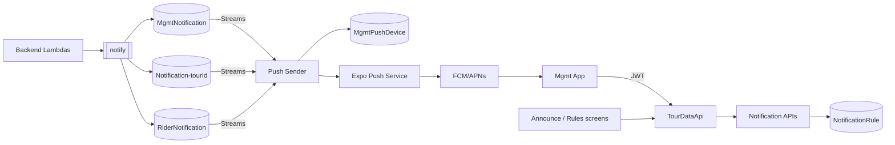

# Notification design reference (tour-mgmt-app)

This app follows the notification framework owned by `kvijay77-in/tour-data-api`:

- Source of truth: `kvijay77-in/tour-data-api/docs/notification-framework-design.md`
- This document is a quick implementation summary for frontend contributors.

## Integration overview

## Frontend constraints

- Push is the primary alert channel; inbox API is the source of truth.
- Web users get bell + inbox (no device push registration in web).
- Do not add a new `EXPO_PUBLIC` variable for push token auth; Expo access token stays in backend SSM only.
- Use `app.json` `extra.eas.projectId` when requesting Expo push tokens.
- Route targets from notification payloads must use the allow-list:
  `NOTIFICATIONS`, `DASHBOARD`, `RIDE_INFO`, `EVENTS_HOME`, `HOTEL_MANAGEMENT`.
  Unknown targets must open the inbox.
