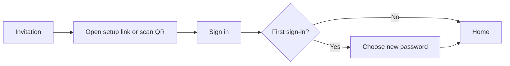
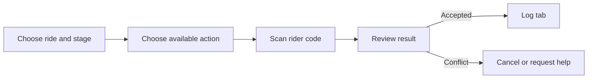

# Using the Tour Management app

_Last updated: 2026-09-29_

This guide is for organizers and staff using the app during a tour. Your organizer decides which role and tours you can access. If a tile or action is missing, ask an Administrator to check your role and assignment.

## Start here: setup and sign-in

1. Install the app using the invitation from your organizer.
2. On a new device, open the **setup link** in the invitation or choose **Scan QR code** on the setup screen. A reinstall may need the setup link again. Ask your organizer for a fresh invitation if it is missing.
3. Sign in with the username and temporary password supplied by your organizer. At first sign-in, follow the prompt to choose a new password.
4. If you cannot remember your password, choose **Forgot password** on the sign-in screen and follow the recovery prompts. To change a password while signed in, use **Change password** in the account menu.

> 📸 **Screenshot:** First-time organization setup and sign-in

## Choose your work from Home

Home shows only the tasks available to you: **Ride Day**, **Events**, **Hotels & Baggage**, and, for organizers, items under **Administration**. If there is only one available task, the app may open it directly. On a wide browser screen, the same tasks appear in the side menu. Use the account menu to change password, check synchronization status or sign out. The notification bell opens your inbox.

> 📸 **Screenshot:** Home tiles for an Administrator

## Administrator

### Plan tours and rides

Open **Define/Update Tour** to create or update a tour and its dated rides. Add stages in riding order, choose any pit stops and float options, and review before saving. Use **Ride status management** to move a ride through its available states; a closed or historical ride is not open for new check-ins. During today's ride, use **Pit Stop management** in the ride menu to open or close an eligible pit stop.

### Manage events, hotels and riders

Use **Event definitions** to set up activities, then **Events** to manage dated occurrences and view their progress. In **Hotels & Baggage**, maintain hotels, review rooms for a night, adjust a rider's allocation or upload an allocation file. Review all reported file errors if an upload is rejected; no partial allocation should be applied. **Rider exit** records a departure and any applicable baggage disposition. An exited rider remains visible in past progress but cannot be checked in again.

### Manage people, files and messages

Under **Administration**, use **New user onboarding** to invite staff, **Enable / Disable user** to control access, **Modify user** to update an account, and **Delete user** only when removal is intended. Use **Tour assignments** to give staff the right tour, event and stage access. **Rider profile definitions** determines which rider details are collected and visible; restricted details are hidden from unauthorized users. **Artifacts** manages tour files and available ride-specific files. **Announce**, **Send reminders** and **Notification Rules** manage outgoing messages. Check the inbox for messages addressed to you.

> 📸 **Screenshot:** Tour setup, user onboarding and announcements

## Super User

Use **Ride Day** for progress and permitted check-ins, and **Define/Update Tour** to review tour information without changing it. In **Events**, manage occurrences and scan activities; use **Hotels & Baggage** for hotel allocations and baggage work. You may record **Rider exit**. You cannot edit ride definitions or status, event definitions, user assignments, artifacts or outgoing notification rules and announcements; ask an Administrator for those changes.

## Pit Stop user (PS_1_USER through PS_5_USER)

Use **Ride Day** to see progress and scan riders arriving at your assigned pit-stop stage. If assigned more than one pit stop, select the active stage before scanning. From the ride menu, **Pit Stop management** lets you open or close only your assigned pit stops when eligible. You may record **Quit Riding** for a rider, but not **Not Riding** or a manual check-in. **Events** shows activities assigned to you for today; if none are assigned, contact your organizer.

## Hotel Staff

Use **Ride Day** to scan riders finishing at the Finish stage; the ride dashboard is not available to this role. In **Events**, scan activities assigned to your hotel and date, such as baggage handling. Hotel allocation management belongs to Administrators and Super Users. If you cannot see an expected activity, ask your organizer to check your assignment.

## Guest

Use the **Ride Day** dashboard to follow current and past ride progress without changing it. **Events** can show available progress, including rider progress; you cannot record check-ins or manage occurrences, hotels, baggage, people or files.

## Follow a ride on the dashboard

Open **Ride Day → Dashboard**. Each rider tile shows an ID; the legend explains stage colors. The default grid shows the latest known stage. A **Float** badge means the rider will join at a later stage, not that they have arrived; **Not Riding** and **Quit Riding** have distinct colors, and **X** marks a rider who exited the tour. Stage counts include riders who passed that point.

Tap a stage to compare every rider with that stage; tap again to return to the whole ride. Sort by stage or rider ID and zoom to see more rider details where available. Tap a tile for the rider card and check-in history. Choose a past ride to look back; it is read-only. The **Log** tab lists recorded entries and, where allowed, provides a cancellation action.

> 📸 **Screenshot:** Dashboard grid (normal zoom)
>
> 📸 **Screenshot:** Stage filter, rider card and check-in log

## Record and correct check-ins

Open **Ride Day → Check-In**, confirm today's ride and stage, choose the available check-in type and scan the rider's code. Review the confirmation before moving on. At Start, organizers may mark a rider **Not Riding** before departure or **Float** to a configured later stage. After departure, eligible staff may record **Quit Riding**. Where a manual option is shown, enter the rider ID when scanning is unavailable. An unfamiliar code, ineligible rider, wrong stage or conflicting status will not be accepted.

To correct an entry, open **Ride Day → Log**, choose the entry and use **Cancel** when available, then confirm. For conflicting Start decisions, follow the **Override or Cancel** prompt; do not repeat the scan until the old decision has been cancelled. These corrections require a connection.

> 📸 **Screenshot:** Check-in scan, confirmation and cancellation

## Events, baggage and rider progress

From **Events**, select an active occurrence to view its dashboard or a rider's progress. Authorized staff choose an activity and scan the correct rider or baggage code, then confirm the result. Use **Baggage reconciliation** to review missing or unmatched movements before resolving them; do not treat a scan as a completed handover until confirmed. Available choices depend on your assignment and the occurrence's status.

> 📸 **Screenshot:** Event scan, occurrence dashboard and baggage reconciliation

## Notifications and working without a connection

Tap the bell for your **inbox**; tap a message to open the relevant screen if you have access. Administrators can send announcements, reminders and configure rules from Home. If you decline phone alerts, you can still use the inbox.

On mobile, a connection banner shows when you are offline. Previously loaded ride information can still be viewed and supported check-ins and event scans can wait on this device for delivery. The app must have been set up and data loaded before going offline. A pending action is **not yet confirmed**: when connectivity returns, open **Sync Status** to review pending or failed items and retry or verify as prompted. **Advanced Settings** on mobile (except Guest) has offline and local-content controls. Do not clear local content while work is pending. Hotel edits, user management, rider exit and Start-stage overrides need a live connection; the browser does not offer mobile offline storage.

> 📸 **Screenshot:** Offline banner, Sync Status and Advanced Settings

## Frequently asked questions

**Why is a tile missing?** Your role or tour assignment does not allow it. Ask an Administrator to check your access.

**Why won't a scan work?** Check that you selected the right ride, stage and activity, and that the rider is eligible. Try again with better lighting; if a manual option is available, use the rider ID. If the app reports a conflict, do not create a second entry.

**Why is my entry not on another phone yet?** It may still be pending on this device. Reconnect and check Sync Status. If delivery fails, show the error to your organizer rather than recording the action again.

**I changed phones or forgot my setup link.** Ask your organizer to resend the invitation. Password recovery alone does not set up a new device.

**Why can't I edit a past ride?** Past ride views are read-only. Ask an Administrator if a correction is required.
